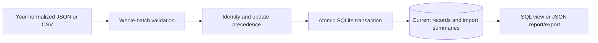

# Mission Control: a local snapshot importer, with a workflow demo

Import JSON or CSV exports into SQLite, reject inconsistent batches, skip duplicate records, and report which observations are stale or missing. Use the **CLI or Python API independently of the browser demo**.

For example, you receive a daily export from an editorial tracker or reporting tool. Normalize it to the documented contract, import it, and query the latest records without double-counting a replay or treating a new import as fresh evidence. The importer does not collect data from those services; you supply the files.

**Standard library only.** Python 3.11+ with SQLite JSON support (normally bundled), no pip packages or account setup. Verified on Python 3.14/macOS; other environments are not yet tested.

## Start with the importer

```sh
git clone https://github.com/vladprosper/mission-control-demo.git
cd mission-control-demo
python3 -m mission_control --as-of 2026-10-19T12:00:00Z validate examples/importer/records.json
python3 -m mission_control --db output/tutorial.sqlite3 --as-of 2026-10-19T12:00:00Z import examples/importer/records.json
python3 -m mission_control --db output/tutorial.sqlite3 --as-of 2026-10-19T12:00:00Z import examples/importer/records.csv
python3 -m mission_control --db output/tutorial.sqlite3 --as-of 2026-10-19T12:00:00Z import examples/importer/newer.json
python3 -m mission_control --db output/tutorial.sqlite3 --as-of 2026-10-19T12:00:00Z report
python3 -m mission_control --db output/tutorial.sqlite3 --as-of 2026-10-19T12:00:00Z export > output/export.json
```

Use a new database path for a clean run. Expected results: validation reports 2 unique records without accessing a database; JSON inserts 2; CSV skips 2 duplicates; the newer snapshot updates 1. The report contains 1 scheduled and 1 verified record, 1 stale observation and 1 missing metric. The other metric is an observed **zero clicks**, not missing. Every example record and evidence reference is invented.

To see whole-batch rejection, run:

```sh
python3 -m mission_control --db output/tutorial.sqlite3 --as-of 2026-10-19T12:00:00Z import examples/importer/invalid.json
```

It exits **2**, reports the invalid second row on stderr, and leaves records and import summaries unchanged. Successful commands emit JSON on stdout and exit 0. Omit `--as-of` for current UTC time when working with your own exports. On Windows use `py -3` in place of `python3`.

## Use it from Python

Run from the checkout root, or add the checkout to your Python import path:

```python
from contextlib import closing
from mission_control import connect, initialize, load_file, import_records, report, timestamp

as_of = timestamp("2026-10-19T12:00:00Z")
with closing(connect("output/api-example.sqlite3")) as db:
    initialize(db)
    counts = import_records(db, load_file("examples/importer/records.json"), as_of)
    result = report(db, as_of, freshness_days=14)
    print(counts)
    print(result["quality"])
    for row in db.execute("SELECT source, external_id, status, metric_value FROM record_details"):
        print(dict(row))
```

There is no package installation or hosted service involved. [API and CLI reference](docs/IMPORTER.md) · [Input contract](docs/DATA_CONTRACT.md) · [SQL schema and version policy](docs/SCHEMA.md).

## What the code guarantees

| Behavior | Implementation |
| --- | --- |
| Validate the entire file before writes | Required fields, five statuses, dates, finite metrics, duplicate identities and HTTPS reference format |
| Commit a batch atomically | Records and successful import summary share one SQLite transaction; late conflicts roll back earlier writes |
| Replay without replacing unchanged records | Canonical SHA-256 content comparison under `(source, external_id)`; original `imported_at` retained |
| Accept corrections only when newer | Changed content requires a strictly newer `source_updated_at` |
| Keep missing values and provenance | `null` stays unknown; zero stays zero; observation, source update and import timestamps remain distinct |
| Query without parsing JSON yourself | `record_details` SQL view over current normalized records |
| Refuse unknown database versions | Version and expected column checks; no automatic in-place migration |

Idempotency applies to **record state**, not the entire database: a successful duplicate-only import still adds an import summary. The store keeps latest snapshots, not a complete version history. It never fetches or verifies an evidence URL. A `verified` status means the required fields are consistent, not that an external result was independently checked.

## Input and schema

Your input is a JSON array of records or a CSV with matching field names. A minimal record:

```json
{
  "source": "editorial_tracker",
  "external_id": "ART-101",
  "title": "Synthetic guide to procurement approvals",
  "workstream": "Research",
  "status": "drafted",
  "source_updated_at": "2026-10-19T09:00:00Z"
}
```

Source names are namespaces you choose, not a fixed list of mock connectors. Optional fields include observation dates, intended/submitted/verified timestamps, an HTTPS evidence reference, and a nonnegative numeric metric with its unit. The [contract](docs/DATA_CONTRACT.md) specifies all fields and constraints.



The [schema.sql](mission_control/schema.sql) file is applied by `initialize()`. [SCHEMA.md](docs/SCHEMA.md) explains keys, JSON storage, the SQL view and upgrading from the original unversioned demo.

## Optional fictional walkthrough

A separate six-click story illustrates one article and a recurring review. It contains hardcoded research findings, an owner decision, draft revision and later results. **No agents, scheduled runs, Notion/Metricool calls or publishing actions execute.** Story snapshots and the technical workbench are separate in-memory stores.

```sh
python3 scripts/review.py
```

Open the printed loopback URL on the same computer; keep the terminal open and stop with Ctrl+C. The OS chooses a free port. The launcher seeds a dedicated fictional database in `output/`. Use **How it works** for architecture and `/technical/` for importer experiments. The demo server rejects databases not explicitly marked fictional; use CLI reports or SQL for your own records.

[Walkthrough GIF](https://github.com/vladprosper/vladprosper/blob/main/mission-control-walkthrough.gif) · [Presenter script](docs/DEMO_GUIDE.md) · [Architecture](docs/ARCHITECTURE.md) · [Mock article actions](docs/ARTICLE_ACTIONS.md).

## Tests and documentation

```sh
python3 -m unittest discover -s tests -v
python3 scripts/smoke_test.py
```

**64 tests pass**, plus the CLI/HTTP smoke checks. Tests cover actual transactions and injected failures, duplicate replay, update conflicts, SQL queries, unknown schema refusal, non-mock inputs, export/reimport, a fresh database CLI workflow and the separate story. The smoke script uses temporary files and OS-assigned loopback ports.

- [Importer guide](docs/IMPORTER.md): commands, Python calls, errors and worked example.
- [Data contract](docs/DATA_CONTRACT.md): normalization, validation and provenance.
- [Schema guide](docs/SCHEMA.md): tables, SQL queries and version policy.
- [Developer guide](docs/DEVELOPMENT.md): module map and demo HTTP interface.
- [Test evidence](docs/TEST_RESULTS.md) and [limitations](docs/LIMITATIONS.md).

## Boundaries and reuse

This is a small local utility with a narrow snapshot contract, not a general ETL framework or production agent platform. There are no live integrations, credential handling, authentication, managed backups, background jobs, historical queries or production deployment hardening. Use a dedicated database, follow your data-handling requirements and do not expose the demo server to a network.

Vladimir Stojanovski · [The Sovereign AI](https://thesovereignai.substack.com) · [LinkedIn](https://www.linkedin.com/in/vlads/).

Prepared with AI assistance and executable checks. Published files and examples contain no operational data. No open-source license has been selected; [NOTICE.md](NOTICE.md) describes the current publication terms. Technical reusability is not a license grant.
