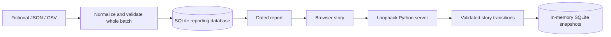

# Mission Control: one article, one recurring review

A small Python/SQLite demo of AI-assisted work that remains understandable: what was planned, what actually ran, what evidence is missing, what the owner decided, and what happens next.

**Everything in the demo is fictional.** No AI model runs and no Notion, Metricool, publishing platform or scheduler is connected. The state validation, SQLite transactions and reporting code are real.

[Watch the narrated walkthrough (3:35)](https://github.com/vladprosper/vladprosper/blob/main/mission-control-walkthrough.gif) · [Architecture](docs/ARCHITECTURE.md) · [Three-minute presenter script](docs/DEMO_GUIDE.md)


## Run locally

Requires **Python 3.11+**, its standard-library SQLite module, and a modern browser. No third-party Python packages, API keys or account setup.

```sh
git clone https://github.com/vladprosper/mission-control-demo.git
cd mission-control-demo
python3 scripts/review.py
```

Open the exact `http://127.0.0.1:...` URL printed in the terminal. The OS selects a free port; keep the terminal open and press **Ctrl+C** to stop. On Windows, use `py -3` in place of `python3`. Windows and Linux have not been tested for this release.

The launcher creates only `output/owner-review.sqlite3` and `output/review-session.json` within this checkout. There is no service, login item or scheduled task. The story is in memory and resets when the server stops. All browser tabs on one server share its story state.

## Try the story

Choose **Restart story**, then follow the green button through six clicks:

1. Open the paused article's scheduled research review.
2. Inspect a completed sample run: three sources read, one unavailable.
3. Compare the finding with the unchanged draft.
4. Record the owner's decision and revise draft v3 to v4.
5. Jump to later fictional publication results, keeping views and impressions separate.
6. Carry a reader's question into the same recurring review.

**How it works** shows the architecture. **Open manuscript**, **Open Notion record** and **Continue conversation** show local mock targets; none opens or writes real work. See [article actions](docs/ARTICLE_ACTIONS.md).

## Why inspect this code?

The project is useful for learning and discussing concrete implementation patterns:

| Problem | Implementation to inspect |
| --- | --- |
| An invalid row must not partially update reporting | Complete-batch validation and atomic transactions in `store.py` |
| CSV replays must not duplicate JSON imports | Normalized content hashes and `(source, external_id)` identity |
| An old browser tab must not apply the same decision twice | Revision checks and allowed transitions in `story.py` |
| A fresh import must not disguise stale evidence | Separate observation, update and import timestamps |
| Missing data must not look like observed zero | Explicit `null` values and unit-aware reporting |
| A preview must not mutate the baseline | Copied SQLite sandbox and single-use apply tokens in `workbench.py` |

This is a reference demonstration, not a ready-made agent platform. Review [limitations](docs/LIMITATIONS.md) before adapting it.

## Explore the importer

The optional `/technical/` page contains reporting views and a preview/apply workbench. These fixtures are separate from the article story. The fixed report time is `2026-10-19T12:00:00Z`; it is a reproducible example, not today's data.

Run these commands from the repository root against a new database:

```sh
python3 -m mission_control --db output/tutorial.sqlite3 --as-of 2026-10-19T12:00:00Z import examples/synthetic.json
python3 -m mission_control --db output/tutorial.sqlite3 --as-of 2026-10-19T12:00:00Z import examples/synthetic.csv
python3 -m mission_control --db output/tutorial.sqlite3 --as-of 2026-10-19T12:00:00Z import examples/invalid-batch.json
python3 -m mission_control --db output/tutorial.sqlite3 --as-of 2026-10-19T12:00:00Z import examples/newer-update.json
python3 -m mission_control --db output/tutorial.sqlite3 --as-of 2026-10-19T12:00:00Z report
```

Expected: JSON inserts 12 records; CSV skips 12 duplicates; the invalid batch exits **2** and writes nothing; the newer update changes N-01 from planned to drafted. The deliberately failing command is expected—run the next command afterward. For another clean run, use another new database filename throughout.

Baseline: 2 planned, 3 drafted, 2 scheduled, 2 submitted, 3 verified; 3 stale observations, 2 unknown source dates and 6 missing metrics. Freshness is ≤7 days; absent dates stay unknown. `scheduled` creates no job, `submitted` proves no delivery, and `verified` means fictional evidence fields passed structural checks. [Full data contract](docs/DATA_CONTRACT.md).

## Architecture and documentation



The two flows are separate: story actions do not import platform data. The technical workbench copies reporting data into its own in-memory sandbox. [Architecture and reference workflow](docs/ARCHITECTURE.md) explains the distinction.

- [Developer guide](docs/DEVELOPMENT.md): code map, HTTP contract, extending fixtures and checks.
- [Data contract](docs/DATA_CONTRACT.md): fields, atomicity, update precedence and provenance.
- [Demo guide](docs/DEMO_GUIDE.md): click-by-click narration and optional architecture explanation.
- [Test results](docs/TEST_RESULTS.md): reproducible commands, coverage and limits.
- [Limitations](docs/LIMITATIONS.md): simulation and deployment boundaries.

## Verify

```sh
python3 -m unittest discover -s tests -v
python3 scripts/smoke_test.py
```

The smoke test uses a temporary database and free loopback ports; it does not touch a running demo. It exercises JSON/CSV imports, rollback, read-only reporting, HTTP action guards, workbench preview/apply/reset and the entire six-click story.

## Troubleshooting

- **URL does not open:** start the launcher again and use its newly printed URL on the same computer. A closed terminal means the foreground server stopped.
- **Python command missing:** install Python 3.11 or newer; on Windows try `py -3 --version`.
- **Port occupied:** omit `--port` to let the OS choose. Never stop another application's server to run this demo.
- **Stale revision after another tab changed the story:** reload the page to obtain the current state, or restart the story.
- **Database from earlier experiments:** use a fresh checkout or another database path for CLI work. Do not point the demo at an operational database.

## Author and reuse

Vladimir Stojanovski · [The Sovereign AI](https://thesovereignai.substack.com) · [LinkedIn](https://www.linkedin.com/in/vlads/)

Prepared with AI assistance and executable checks. No employer materials, operational databases or credentials are included. No open-source license has been selected for this initial source publication; see [NOTICE](NOTICE.md). Public visibility should not be described as an open-source license grant.
