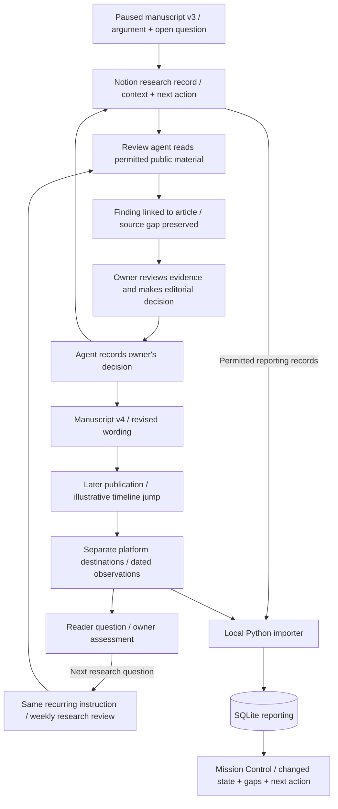
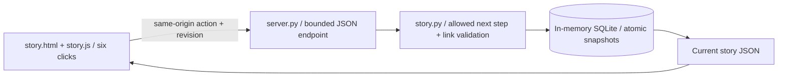
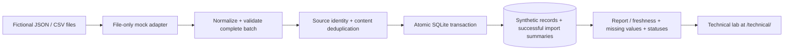

# Importer core and optional article walkthrough

The main experience follows a fictional article, **“When AI agents negotiate a purchase”**. It illustrates the workflow described in [The Architecture Behind My AI Assisted Work](https://github.com/vladprosper/vladprosper/blob/main/The%20Architecture%20Behind%20My%20AI%20Assisted%20Work.docx). The reference workflow and the code implemented here are deliberately distinguished below.

The reusable `load_file`, `prepare_batch`, `import_records` and `report` functions are independent of the story. They accept normalized local exports into a versioned SQLite schema and queryable SQL view. See [IMPORTER.md](IMPORTER.md) and [SCHEMA.md](SCHEMA.md). The diagrams below distinguish that working core from the scripted workflow.

## Reference workflow behind the story

The schedule is a recurring instruction, not another agent. A run is an observed occurrence of that instruction. Finishing a run does not mean its findings are complete or that the owner has accepted them. The 12 September example finishes with three of four sources read and an owner decision pending. The unavailable source keeps its previous observation date.

Agents write decisions and next actions in the research record; manuscript files hold the wording. The owner decides what the evidence means. The local importer reads permitted reporting records and writes SQLite. **It does not write to Notion.**

The fictional decision separates permission to negotiate price from permission to change contractual terms. The same manuscript later has distinct Substack and LinkedIn destination identities. Views and impressions keep separate definitions, collection dates and periods. Subscriber impact remains unknown. The reader question becomes the next instruction for the same recurring review; the answer is not assumed.

This story uses personal research and permitted public material. The wider reference architecture also separates employer and personal ownership, sensitivity, permitted reporting and recovery responsibilities. Those details are outside the three-minute story. No protected store, operational database or private project is needed to demonstrate the loop.

## Implemented narrative

`story.py` owns one article ID and one recurring-review ID. Every action checks the expected revision and allowed next step. It validates the finding→run/article, owner-decision→finding, draft→decision, publication→manuscript and next-question→same-review relationships before committing a snapshot. An injected SQLite failure leaves the prior snapshot unchanged. A stale tab cannot apply an old revision twice.

The story state is separate from the synthetic reporting fixture database. It does **not** run the technical importer or edit actual source documents when the screen says a simulated agent saved a record. Agent work, source collection, Notion, manuscript edits, recurring runs and publication observations are scripted fixtures. Python, HTTP actions, state validation and SQLite snapshot commits are real. All tabs share the current server state; restart returns the scenario to its initial state with a new revision, and server restart discards its memory.

## Optional importer lab

| Component | Responsibility |
| --- | --- |
| `story.py` | Scripted article/review state, relationship validation, revision checks and in-memory SQLite snapshots. |
| `static/story.*` | Focused narrative interface, presenter notes and optional architecture explanation. |
| `adapters.py` | Local JSON/CSV reading, with a compatibility alias for mock examples. |
| `store.py` | Batch validation, normalization, deduplication, atomic imports and report projection. |
| `portfolio.py` | Separate technical fixtures for release/domain rules and destination attribution. |
| `workbench.py` | In-memory reporting copy; previews on another copy; current single-use token before apply; reset. |
| `server.py` | IPv4 loopback development server; fixed assets, read-only source DB projection and bounded same-origin story/workbench actions. |
| `scripts/review.py` | Foreground local launcher with an OS-assigned free loopback port; Ctrl+C stops it. |

The importer stores normalized row JSON and digest under source/ID identity. Successful import summaries commit with the rows. Source observation dates never become current merely because an import occurred. Unknown values remain unknown, observed zeros remain zeros, and status names do not imply actual external actions. The workbench's previews and writes affect only its sandbox, not the source database or story snapshots.

The importer accepts HTTPS evidence references but never fetches them. No component calls Notion, Metricool, an AI model, an employer system or an existing Mission Control database. No encryption, identity enforcement, live integration, backup/restore or production deployment is implemented or claimed.
