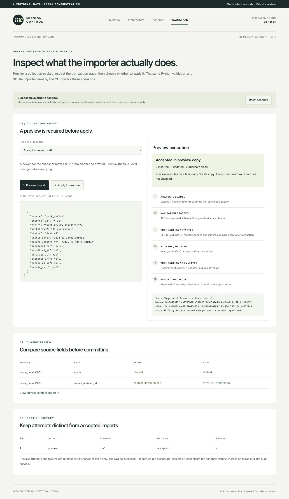

# Preview an import before applying it

The technical workbench runs the real importer against disposable in-memory SQLite copies. Start `python3 scripts/review.py`, open the printed URL, then visit `/technical/` and select **Workbench**.

*Existing technical-lab capture: a newer draft passes preview; the sandbox has not changed. All records are fictional. Click the image for the full-size view. The capture predates the article-story landing page; its workbench flow remains implemented.*

## From preview to apply

1. **Choose a scenario.** For example, **Accept a newer draft** supplies one fictional record, `mock_notion/N-01`, with status `drafted` and a newer source update timestamp. The scenarios are fixed examples, not file-upload connectors.
2. **Preview import.** The workbench copies the current sandbox to a temporary SQLite database and calls the importer there. It shows validation, transaction events, counts, and before/after fields. The screenshot's transaction commits in that temporary copy; it does not change the active sandbox or the source database.
3. **Review the changes.** In this example, expect zero inserts, one update and zero duplicate skips. The diff shows `planned → drafted` and the newer `source_updated_at`. Inspect both the change and its provenance.
4. **Apply to sandbox.** Apply requires the token from the latest accepted preview, matching its scenario and sandbox revision. The workbench consumes that token and reruns the scenario against the active in-memory sandbox. An accepted apply increments its revision. A second apply with the same token is rejected.
5. **Reset when finished.** Reset restores the in-memory baseline, advances the revision and invalidates pending previews. The original database stays unchanged throughout.

For example, **Roll back a partial write** stages a new row and then encounters a conflicting older snapshot. The transaction rolls back; matching before/after fingerprints show that neither records nor successful-import summaries survived the failed attempt. A rejected preview cannot be applied.

## Implementation and limits

[workbench.py](../mission_control/workbench.py) uses SQLite backup to make copies, a lock to serialize workbench operations, and an in-memory token bound to `(revision, scenario, accepted)`. Starting another preview replaces the previous pending token. Apply reruns the fixed scenario; it does not persist an approved arbitrary payload. This is a local demonstration of reviewing imports, not an authenticated approval service.

The session history is bounded and disappears on reset or restart. Successful-import summaries belong to the sandbox; failed attempts are not a durable audit log. There are no live integrations or external publishing actions. The standalone CLI imports directly into its specified database and does not require this preview flow.

[Workbench tests](../tests/test_workbench.py) cover preview isolation, rejected/stale/replayed tokens, scenario mismatch, rollback and baseline preservation. See [test evidence](TEST_RESULTS.md) for the recorded suite and smoke results.
